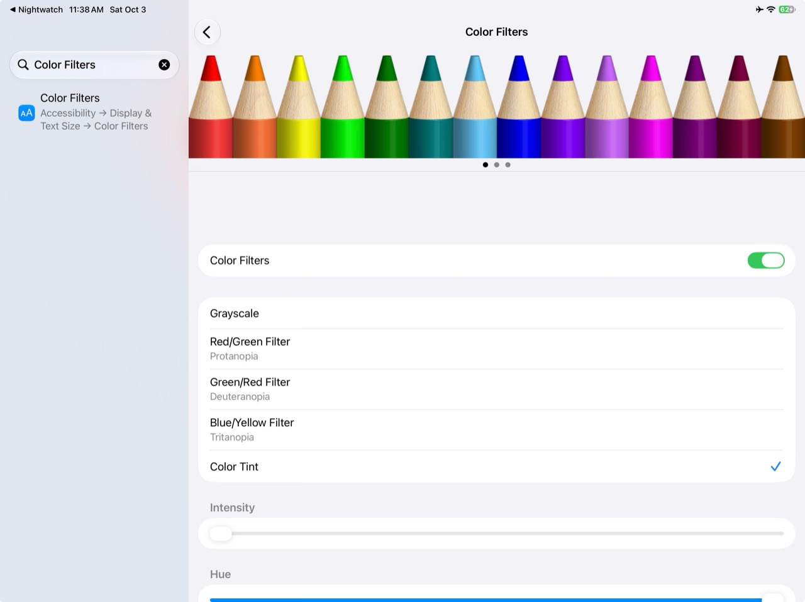

# Nightwatch for iOS

Set up a red screen tint that follows a Nightwatch Focus, across apps and the Lock Screen. This repository contains instructions for Apple's built-in Settings and Shortcuts. You do the setup once, then use Focus to switch Nightwatch on and off.

The intended result:

| When | What happens |
| --- | --- |
| Nightwatch Focus turns on | Color Filters turns on using your saved red tint |
| Nightwatch Focus turns off | Color Filters turns off |
| You run the optional Nightwatch Toggle shortcut | Color Filters switches state without changing Focus |

The manual Focus-triggered toggle has worked in device testing. The separate On and Off automation recipe below still needs a complete device test, especially the Off path. See [findings and remaining checks](docs/findings.md).

## Project documentation

- [Technical findings and API limits](docs/technical-findings.md): device evidence, reusable code patterns, and unresolved questions for Apple.
- [The ideal Nightwatch app](docs/ideal-app-experience.md): the intended paid app, setup, everyday controls, and repair experience.
- [Findings and remaining checks](docs/findings.md): verification still needed for the instructions.

## 1. Create the shortcuts

If Nightwatch On and Nightwatch Off already exist, skip to [saving the red tint](#2-save-the-red-tint), or [connecting Focus](#4-connect-focus-to-the-shortcuts) if your tint is already configured.

In Shortcuts, open the description-based builder and paste each block separately. Keep these exact names so the automations can reference them.

### Nightwatch On

```text
Create a shortcut named exactly "Nightwatch On". Add one Set Color Filters action configured to Turn On. Use the existing color filter selected in Accessibility settings. Do not use Toggle, change brightness, add an automation, show an alert, or open another app.
```

### Nightwatch Off

```text
Create a shortcut named exactly "Nightwatch Off". Add one Set Color Filters action configured to Turn Off. Keep the saved filter type, hue, and intensity unchanged. Do not use Toggle, change brightness, add an automation, show an alert, or open another app.
```

### Nightwatch Toggle, optional

```text
Create a shortcut named exactly "Nightwatch Toggle". Add one Set Color Filters action configured to Toggle. Use the existing color filter selected in Accessibility settings. Do not change brightness, add an automation, show an alert, or open another app.
```

Toggle is a manual override. Keep it out of the Focus automations, where it could turn the filter off when you wanted it on.

Inspect each generated shortcut against this table. If the builder is unavailable, create a new shortcut, search for **Set Color Filters**, configure its action as shown, and save it with the exact name. There are no shared install links in this repository yet.

| Shortcut | Entire action list |
| --- | --- |
| Nightwatch On | Turn Color Filters On |
| Nightwatch Off | Turn Color Filters Off |
| Nightwatch Toggle, optional | Toggle Color Filters |

Run Nightwatch On. A device with the default filter may become grayscale. That shows the action is working; the next step changes the saved filter to red. If you already have a different filter selected, that filter will appear instead.

## 2. Save the red tint

1. Open Settings and search for **Color Filters**. The full path is **Accessibility → Display & Text Size → Color Filters**.
2. Keep Color Filters on and select **Color Tint**, at the bottom of the filter list. Do not select Red/Green Filter.
3. Scroll down to the sliders. On iPhone, they may be below the visible part of the screen.
4. Move **Intensity** all the way right. Adjust **Hue** until the display is red.
5. Return to Shortcuts. Run Nightwatch Off, then Nightwatch On. Regular colors should return, followed by the same red tint.

This is our provisional red preset. Research into hue, intensity, and night-vision performance is still outstanding. Adjust screen brightness separately for the conditions.

| Find Color Tint, then scroll down for the sliders |
| --- |
|  |
| Reference for finding the controls. The screenshot's low Intensity is not the target setting. |

The shortcut only changes whether Color Filters is enabled. Hue, intensity, and filter type are configured in Settings. If you use a different accessibility filter every day, this setup changes that saved selection; Nightwatch Off disables the filter rather than restoring your previous selection. [Apple's Color Filters guide](https://support.apple.com/guide/iphone/iph3e2e1fb0/ios).

## 3. Create Nightwatch Focus

Open **Settings → Focus → + → Custom**. Name it **Nightwatch**, choose a red icon color and an icon you recognize, then finish creating it. Review People and Apps so its notification rules suit you.

Focus will be the everyday control for the tint, your chosen screens, and your schedule. [Apple's Focus setup guide](https://support.apple.com/guide/iphone/iphd6288a67f/ios).

## 4. Connect Focus to the shortcuts

Personal automations listen for Focus changes. The shortcuts themselves do not watch anything in the background.

These prompts assume that the Nightwatch Focus and the shortcuts named exactly **Nightwatch On** and **Nightwatch Off** already exist. Paste each block separately into the automation description builder.

### When Nightwatch turns on

```text
Create a personal automation for the existing Focus named "Nightwatch". Trigger it only When Turning On, not When Turning Off. Set it to Run Immediately without asking for confirmation. Add one Run Shortcut action that runs my existing shortcut named exactly "Nightwatch On". Do not create another shortcut, toggle Color Filters, change the Focus, or add other actions.
```

### When Nightwatch turns off

```text
Create a personal automation for the existing Focus named "Nightwatch". Trigger it only When Turning Off, not When Turning On. Set it to Run Immediately without asking for confirmation. Add one Run Shortcut action that runs my existing shortcut named exactly "Nightwatch Off". Do not create another shortcut, toggle Color Filters, change the Focus, or add other actions.
```

Review the generated trigger and action against the table below, then save. These prompts still need a device check; a generated action alone does not establish that the Focus trigger was created. If the builder only creates the action or is unavailable, set the trigger manually in **Shortcuts → Automation → +**, selecting Nightwatch in the Focus triggers.

| Trigger | Execution | Action |
| --- | --- | --- |
| Nightwatch, When Turning On only | Run Immediately | Run Shortcut: Nightwatch On |
| Nightwatch, When Turning Off only | Run Immediately | Run Shortcut: Nightwatch Off |

For each automation, choose the saved shortcut if the next screen offers it directly. Otherwise choose a blank automation, add **Run Shortcut**, and select the appropriate shortcut. Save both. On versions showing **Ask Before Running**, turn it off to allow automatic execution.

Disable any existing Nightwatch automation that toggles Color Filters. It would compete with this pair. Check that the On automation does not also have When Turning Off selected, and vice versa.

The actions set an explicit state: running On twice keeps the filter on, and running Off twice keeps it off. Apple documents both [Focus triggers](https://support.apple.com/guide/shortcuts/apde31e9638b/ios) and [automatic execution](https://support.apple.com/guide/shortcuts/apd602971e63/ios).

### Test both directions

Start with Nightwatch Focus off and run Nightwatch Off once.

1. In Control Center, open Focus and turn Nightwatch on. Check that the display becomes red.
2. Open another app and check the Lock Screen. The tint should remain.
3. Turn Nightwatch Focus off. Check that regular colors return.
4. Repeat the cycle. Also test turning Nightwatch off while the phone is locked and switching from Nightwatch to another Focus.

If Off fails, run Nightwatch Off manually to distinguish a shortcut problem from an automation problem. You can always disable Color Filters directly in Settings.

## 5. Put the controls where you need them

### Control Center

Use the built-in **Focus** control and select Nightwatch. This runs the paired automations and keeps the Focus and tint aligned.

For a filter-only override, edit Control Center, choose **Add a Control → Shortcut**, then configure it to run **Nightwatch Toggle**. You can choose Nightwatch Off instead if you want a dedicated return-to-regular-colors control. [Apple's Shortcut control instructions](https://support.apple.com/guide/shortcuts/apd06a9201d4/ios).

A filter-only shortcut does not change Focus. If you override the filter while Nightwatch Focus stays on, the On automation will not run again until the Focus turns off and back on.

### Lock Screen

Touch and hold the Lock Screen, choose **Customize → Lock Screen**, remove one bottom control, and add the **Shortcut** control where available. Select Nightwatch Toggle or Nightwatch Off, then save. Test whether your phone requires unlocking to run it.

You can also link a dedicated Lock Screen to Nightwatch under **Settings → Focus → Nightwatch → Customize Screens**. Choose a dark background and a readable clock. Test activation from that screen as part of the Focus check. [Apple's Lock Screen guide](https://support.apple.com/guide/iphone/iph4d0e6c351/ios).

### Apple Watch face

Create a face with a dark background and red details in the Watch app. Under **Settings → Focus → Nightwatch → Customize Screens**, choose that face below the Apple Watch image. [Apple's Focus watch-face instructions](https://support.apple.com/guide/watch/apd6640937c4/watchos).

A linked watch face changes the face, not every screen on the Watch. The iPhone's red Color Filter does not tint the Watch display.

### Schedule

Go to **Settings → Focus → Nightwatch → Add Schedule** and choose the start time, end time, and days. The Focus transitions should run the same On and Off automations; test one short scheduled cycle before relying on it. [Apple's Focus scheduling guide](https://support.apple.com/guide/iphone/iph5c3f5b77b/ios).

If you share Focus across devices, configure and test the filter and automations separately on each device where you want a red screen.

## Fix an incomplete setup

| What you see | What to check |
| --- | --- |
| Grayscale instead of red | In Settings, select Color Tint and adjust Hue and Intensity |
| Red, but other colors remain | Scroll down and check Intensity; confirm Hue is red |
| Focus turns on but the display stays normal | Run Nightwatch On manually; then check the On automation and automatic execution |
| Red remains after Focus turns off | Run Nightwatch Off manually; check that a separate Off automation exists and uses Off, not Toggle |
| Results seem reversed or inconsistent | Disable duplicate toggle automations and check for a manual filter override |
| A shortcut is missing or was edited | Recreate its single action from the table, then reselect it in the automation and any controls |
| Tint changes unexpectedly | Check other automations and Night Shift; Apple's display guide notes that Night Shift can remove color-filter effects other than grayscale |

Judge the tint on the display itself. Our device screenshots did not capture the red filter; a photograph of the screen did.[^screenshots]

[^screenshots]: The settings image above documents where the controls are. It does not show the filtered appearance seen by the person holding the device.
